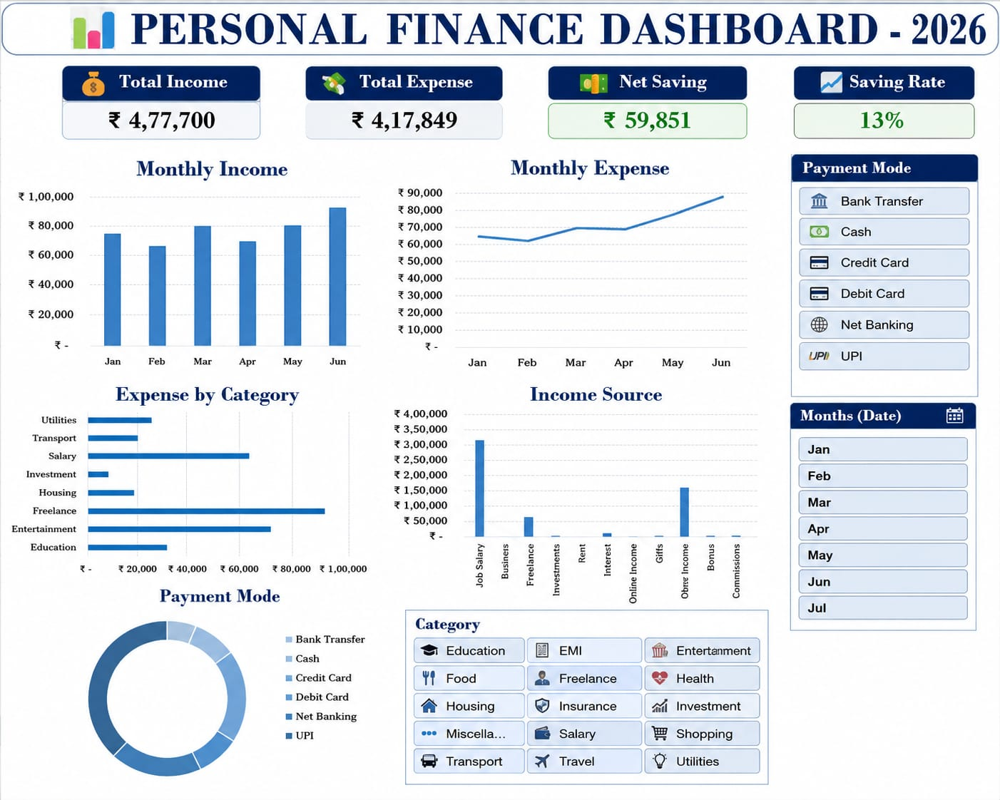

# 📊 Personal Finance Dashboard – 2026

## 📌 Project Overview

The Personal Finance Dashboard is an Excel-based data visualization project designed to analyze income, expenses, savings, and spending patterns through a consolidated dashboard.

I designed and developed the dashboard using sample data prepared with assistance from ChatGPT.

## 🖼️ Dashboard Preview

## 🎯 Project Objectives

- Monitor key financial performance indicators (KPIs).
- Analyze monthly income and expense trends.
- Understand category-wise spending distribution.
- Compare income sources and payment methods.

## 📈 Key Features

- **Financial KPI Monitoring:** Presents Total Income, Total Expense, Net Savings, and Savings Rate for a consolidated view of financial performance.
- **Monthly Trend Analysis:** Uses column and line charts to compare monthly income and expenditure and visualize changes over time.
- **Category-wise Expense Analysis:** Uses a horizontal bar chart to compare spending categories and identify major expense areas.
- **Income Source Analysis:** Visualizes income contributions from different sources for comparative analysis.
- **Payment Mode Distribution:** Uses a doughnut chart to represent the distribution of payment methods.
- **Interactive Filtering:** Displays month, category, and payment mode filter controls for focused data exploration, subject to the underlying Excel configuration.

## 💰 Key Performance Indicators (KPIs)

| Metric | Value |
|---|---:|
| Total Income | ₹4,77,700 |
| Total Expense | ₹4,17,849 |
| Net Savings | ₹59,851 |
| Savings Rate | 13% |

**Net Savings** = Total Income − Total Expense

**Savings Rate** = (Net Savings ÷ Total Income) × 100

The calculated savings rate is approximately 12.53%, rounded to 13%.

## 🛠️ Tools & Technical Concepts

- Microsoft Excel
- KPI Reporting
- Data Visualization
- Time-Series Analysis
- Categorical Analysis
- Financial Ratio Analysis

## 💡 Key Observations

- Displayed net savings are ₹59,851.
- The savings rate is approximately 12.53%.
- Freelance and entertainment appear among the larger expense categories in the displayed chart.

## 📚 Learning Outcomes

- Practiced dashboard design and visual reporting.
- Developed an understanding of KPI presentation and chart selection.
- Practiced communicating financial data through visualizations.

## 🚀 Future Enhancements

- Include the original Excel workbook and sample dataset.
- Validate calculations against the underlying data.
- Add budget-versus-actual analysis.

## 👩‍💻 Project Credits

- **Dashboard Design:** Created by me
- **Tool:** Microsoft Excel
- **Sample Data:** Prepared with assistance from ChatGPT

*Note: This repository currently contains the dashboard image and documentation, not the original Excel workbook.*
